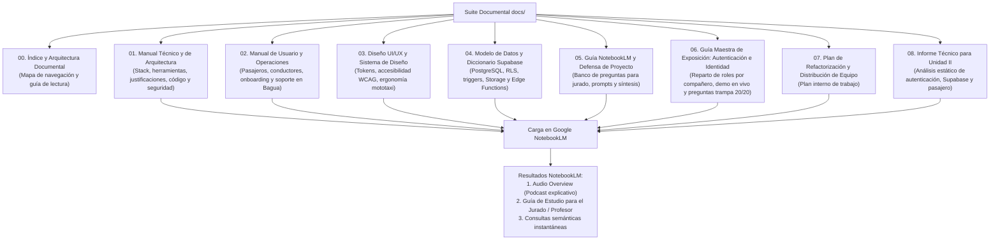

# SUITE DOCUMENTAL DE ALTOKKE MÓVIL
## Catálogo Maestro, Arquitectura Documental y Guía de Ingestión para NotebookLM

**Proyecto**: Altokke Móvil — Sistema Inteligente de Despacho y Transporte Urbano en Mototaxi  
**Curso Universitario**: Programación de Aplicaciones Móviles (Android & iOS)  
**Ámbito Territorial**: Bagua, Departamento de Amazonas, Perú  
**Versión de la Suite**: 1.2.0 (Edición Especial: Optimización de Rendimiento de Listas con FlashList v2, Reciclaje Nativo de Celdas y Seguridad Criptográfica)  
**Fecha de Publicación**: Octubre 2026  
**Clasificación**: Documentación Oficial del Sistema (Técnica, Operativa, Diseño, Defensa de Exposición e Ingestión IA)

---

## 1. PROPÓSITO DE LA SUITE DOCUMENTAL

La carpeta `docs/` contiene el cuerpo exhaustivo de conocimiento técnico, arquitectónico, de diseño y operacional de **Altokke Móvil**. Esta suite ha sido diseñada para cumplir con tres propósitos de alta exigencia:

1. **Exposición Académica de Alto Nivel (Curso de Programación Móvil)**: Servir como guía pedagógica y técnica para que el equipo exponga con maestría el módulo de **Autenticación e Identidad**, demostrando por qué se tomaron decisiones de nivel Staff (validación con RENIEC, flujo PKCE, moderación visual en el Edge con Sightengine, y el motor híbrido AES-256 CTR para superar el límite de 2048 bytes de Android Keystore).
2. **Excelencia en Ingeniería de Software y Auditoría**: Proporcionar a evaluadores universitarios y arquitectos de software una radiografía milimétrica del código, con explicaciones sobre **por qué** se tomó cada decisión técnica, **qué problema** resuelve, **qué alternativas** fueron descartadas y **en qué archivos exactos** del repositorio se implementa cada herramienta o servicio.
3. **Ingestión Óptima para Google NotebookLM**: Todos los documentos están estructurados en formato Markdown modular y enriquecido con lenguaje claro, definiciones formales, diagramas conceptuales, tablas comparativas y metadatos cruzados. Esto permite que la inteligencia artificial de NotebookLM sintetice resúmenes ejecutivos, genere episodios de podcast ("Audio Overview") con precisión milimétrica y sirva como tutor interactivo para la sustentación o capacitación del equipo.

---

## 2. MAPA DE DOCUMENTOS Y DESCRIPCIÓN DE CONTENIDOS

A continuación se detalla la matriz de documentos que componen la carpeta `docs/`:

| Archivo | Documento | Audiencia Principal | Contenido Esencial |
| :--- | :--- | :--- | :--- |
| **`00_INDICE_Y_ARQUITECTURA_DOCUMENTAL.md`** | Índice y Guía Maestra | Todos los perfiles | Resumen ejecutivo, índice cruzado, mapa mental y guía de uso para NotebookLM. |
| **`01_MANUAL_TECNICO_Y_ARQUITECTURA.md`** | Manual Técnico y de Arquitectura | Jurado Técnico, Docente de Móviles, Desarrolladores | Desglose exhaustivo de los módulos de autenticación, identidad con RENIEC, flujo PKCE, moderación IA con Sightengine, arquitectura criptográfica híbrida AES-256 CTR + Hardware Enclave, catálogo de 57 dependencias con los 4 pilares obligatorios. |
| **`02_MANUAL_DE_USUARIO_Y_OPERACIONES.md`** | Manual de Usuario y Operaciones | Usuarios Finales, Jurado Operativo, Soporte | Guía paso a paso para Pasajeros y Conductores en Bagua. Onboarding con validación RENIEC, solicitud y negociación de carreras, activación de turnos, verificación de antecedentes y soporte vía WhatsApp. |
| **`03_DISENO_UI_UX_Y_SISTEMA_DE_DISENO.md`** | Diseño de la App y Design System | Diseñadores de Producto, Jurado UI/UX | Sistema "Altokke Emerald Dark", paleta cromática de alto contraste (WCAG 2.1 AA/AAA), ergonomía táctil para uso en mototaxi en movimiento (mínimo 48x48px), tipografías Outfit y Quicksand, flujos de usuario (User Flows). |
| **`04_MODELO_DE_DATOS_Y_DICCIONARIO_SUPABASE.md`** | Diccionario de Datos y Base de Datos | DBAs, Auditores de Backend, Evaluadores | Esquema relacional PostgreSQL 15, entidades (`usuarios`, `conductores_perfil`, `pasajeros_perfil`, `vehiculos`, `viajes`, `documentos`), políticas RLS (Row Level Security), triggers de cálculo y Storage Buckets. |
| **`05_GUIA_NOTEBOOKLM_Y_DEFENSA_DE_PROYECTO.md`** | Guía de Ingestión y Defensa Académica | Estudiantes sustentantes, Docentes, Jurados | Instrucciones de carga a Google NotebookLM ("Altokke Móvil — Proyecto de App Móvil para Android e IOs"), resumen ejecutivo para la IA, 10 preguntas y respuestas críticas de sustentación técnica, y prompts para generar podcasts de audio. |
| **`06_GUIA_EXPOSICION_AUTENTICACION_E_IDENTIDAD.md`** | Guía Maestra de Exposición para el Curso | Compañeros de Equipo de Exposición | Reparto estratégico de 4 roles (Criptografía, APIs & RENIEC, UI & Formularios Yup, Cloud & Visión IA), guion paso a paso por integrante, flujo de demo en vivo y banco de preguntas trampa del docente con respuestas 20/20. |
| **`07_PLAN_DE_REFACTORIZACION_Y_DISTRIBUCION_DE_EQUIPO.md`** | Plan de Refactorización | Equipo de desarrollo | Plan interno de mejora y distribución del trabajo. |
| **`08_INFORME_UNIDAD_II_ANALISIS_TECNICO.md`** | Informe técnico de Unidad II | Equipo expositor y evaluador técnico | Análisis trazable al código de autenticación, pasajero, arquitectura, Supabase, APIs, Storage/RLS, entorno y funcionalidades parciales. Distingue implementación comprobada de configuración externa y pendientes. |

Para describir el estado comprobable del código actual, consultar el informe 08 junto con las fuentes. Los manuales previos sirven como contexto, no como evidencia de que una integración/configuración esté desplegada.

---

## 3. CÓMO USAR ESTA DOCUMENTACIÓN EN GOOGLE NOTEBOOKLM

[Google NotebookLM](https://notebooklm.google.com/) es una herramienta de investigación asistida por inteligencia artificial basada en modelos Gemini de contexto extendido. Su ventaja clave es el **anclaje a fuentes (Source Grounding)**: todas sus respuestas y análisis se derivan estrictamente de los documentos que se le cargan, evitando alucinaciones.

### Paso a Paso para la Ingestión:
1. Accede a tu cuenta de Google en [notebooklm.google.com](https://notebooklm.google.com/).
2. Haz clic en el botón **"+ Crear libreta"** y asígnale el título: `Altokke Móvil — Proyecto de App Móvil para Android e IOs`.
3. En la sección **"Fuentes"**, selecciona **"Subir archivos"** o arrastra los 9 archivos `.md` de esta carpeta `docs/`:
   - `00_INDICE_Y_ARQUITECTURA_DOCUMENTAL.md`
   - `01_MANUAL_TECNICO_Y_ARQUITECTURA.md`
   - `02_MANUAL_DE_USUARIO_Y_OPERACIONES.md`
   - `03_DISENO_UI_UX_Y_SISTEMA_DE_DISENO.md`
   - `04_MODELO_DE_DATOS_Y_DICCIONARIO_SUPABASE.md`
   - `05_GUIA_NOTEBOOKLM_Y_DEFENSA_DE_PROYECTO.md`
   - `06_GUIA_EXPOSICION_AUTENTICACION_E_IDENTIDAD.md`
   - `07_PLAN_DE_REFACTORIZACION_Y_DISTRIBUCION_DE_EQUIPO.md`
   - `08_INFORME_UNIDAD_II_ANALISIS_TECNICO.md`
4. **Generación del Podcast (Audio Overview)**:
   - Una vez cargados los documentos, dirígete al panel superior derecho y presiona **"Generar"** en la tarjeta **Guía de audio (Audio Overview)**.
   - NotebookLM creará una conversación podcast entre dos presentadores de IA debatiendo sobre la arquitectura de Altokke, cómo se resolvió la ciberseguridad en Bagua, por qué se usó un enclave de hardware y cómo funciona la verificación de identidad en RENIEC.
5. **Generación de Fichas de Estudio y Preguntas de Repaso**:
   - Puedes usar el chat de NotebookLM seleccionando todas las fuentes y solicitando: *"Genera un simulacro de 10 preguntas difíciles que el profesor de programación de aplicaciones móviles formularía sobre el módulo de autenticación e identidad, indicando las respuestas exactas extraídas del manual técnico"*.
