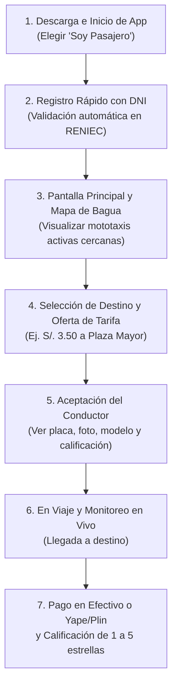
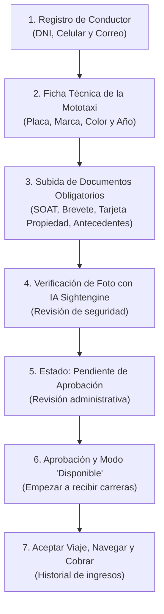

# MANUAL DE USUARIO Y GUÍA DE OPERACIONES
## Altokke Móvil — Transporte Seguro en Mototaxi para Bagua, Amazonas

**Versión**: 1.0.0  
**Dirigido a**: Pasajeros, Conductores de Mototaxi, Operadores de Mesa de Ayuda y Jurado Evaluador  
**Objetivo**: Guía integral, paso a paso, ilustrada con diagramas de flujo y lenguaje claro para la operación cotidiana del sistema.

---

## 1. INTRODUCCIÓN Y CONTEXTO OPERATIVO EN BAGUA

**Altokke Móvil** es la primera plataforma digital diseñada específicamente para transformar y ordenar el transporte urbano en mototaxi en la ciudad de **Bagua, Amazonas, Perú**.

A diferencia de las grandes ciudades donde predominan los automóviles y los taxímetros, en Bagua la mototaxi es el corazón de la movilidad ciudadana: traslada a estudiantes, comerciantes y familias a través de rutas urbanas y periurbanas. Sin embargo, este medio enfrentaba dos grandes problemas:
1. **Inseguridad ciudadana**: Mototaxis informales sin identificación clara, riesgo de asaltos nocturnos y falta de trazabilidad ante la pérdida de objetos personales.
2. **Incertidumbre tarifaria y tiempos de espera**: Largos periodos esperando en las esquinas bajo el sol o la lluvia, y disputas cotidianas sobre el precio justo de la carrera.

Altokke Móvil soluciona estos problemas conectando pasajeros con **conductores formalizados y verificados ante el Registro Nacional de Identificación y Estado Civil (RENIEC)**, permitiendo acordar tarifas justas en tiempo real y garantizando asistencia inmediata.

---

## 2. MANUAL OPERATIVO DEL PASAJERO

### Paso 1: Instalación y Bienvenida
1. Abre la aplicación **Altokke** desde tu teléfono Android o iPhone.
2. En la pantalla inicial de bienvenida, verás el imagotipo de Altokke y dos botones grandes de acceso rápido:
   - Presiona **"Soy Pasajero"**.
3. Si ya tienes una cuenta registrada, ingresa tu correo electrónico (o DNI) y contraseña, o presiona el botón **"Continuar con Google"**.

### Paso 2: Registro Seguro con DNI (Validación Oficial RENIEC)
Para proteger la seguridad de toda la comunidad, el registro de pasajeros es 100% verificado:
1. Si eres nuevo usuario, selecciona **"Crear Cuenta de Pasajero"**.
2. **Ingresa tu número de DNI (8 dígitos)**.
   * *La magia de Altokke*: El sistema se conecta en un segundo con la base de datos oficial de RENIEC y completa automáticamente tus nombres reales y apellidos. Esto garantiza que no existan perfiles falsos en la plataforma.
3. Ingresa tu número de celular (9 dígitos) para que el mototaxista pueda contactarte si es necesario.
4. Define una contraseña segura (mínimo 8 caracteres, combinando letras y números).
5. Opcionalmente, tómate una foto o elige una de tu galería para tu avatar de perfil.

### Paso 3: Solicitar un Viaje y Negociar el Precio
1. Al ingresar a la pantalla principal, el GPS detectará automáticamente tu ubicación actual en Bagua (o puedes mover el marcador en el mapa para ajustar el punto de recogida exacto).
2. En la barra de búsqueda inferior, escribe o selecciona tu lugar de destino (ejemplo: *Mercado Central*, *Hospital Gustavo Lanatta Luján*, *Terminal Terrestre*, *Plaza Mayor*).
3. **Elige tu tarifa propuesta**:
   * Altokke te mostrará un valor de referencia sugerido según la distancia (por ejemplo, `S/. 3.50`).
   * Puedes aceptar la sugerencia o ajustar el monto si llevas paquetes pesados o si el viaje es en horario nocturno.
4. Presiona el botón verde **"Solicitar Altokke"**.

### Paso 4: Confirmación del Mototaxista y Medidas de Seguridad
1. Tu solicitud aparecerá en la pantalla de los mototaxistas disponibles más cercanos.
2. Cuando un conductor acepte tu carrera, la pantalla de tu móvil cambiará inmediatamente y te mostrará:
   * **Foto del conductor y nombre verificado**.
   * **Número de Placa oficial** de la mototaxi (ejemplo: `6521-7K`).
   * **Marca, modelo y color del vehículo** (ejemplo: *Wanxin Azul*).
   * **Calificación promedio en estrellas** (otorgada por otros vecinos de Bagua).
   * **Tiempo estimado de llegada** (ejemplo: *2 minutos*).
3. **Antes de subir a la mototaxi**: Comprueba siempre que el número de placa y el color del vehículo coincidan exactamente con lo indicado en tu pantalla.

### Paso 5: Finalización, Pago y Calificación
1. Al llegar a tu destino, el conductor marcará el viaje como terminado.
2. Abona la tarifa acordada:
   * Puedes pagar en **efectivo**.
   * O puedes solicitar al conductor su código QR de **Yape o Plin** para pagar desde tu billetera móvil.
3. Califica al conductor de 1 a 5 estrellas y, si lo deseas, deja un comentario sobre la limpieza y amabilidad del servicio. Tu valoración ayuda a mantener solo a los mejores mototaxistas en Altokke.

---

## 3. MANUAL OPERATIVO DEL CONDUCTOR (MOTOTAXISTA)

El conductor es el socio estratégico de Altokke. La aplicación de conductor está optimizada para ser utilizada con una sola mano y montada en el soporte de timón de la mototaxi, con botones gigantes de alto contraste para máxima visibilidad bajo la luz solar intensa de Bagua.

### Paso 1: Postulación y Registro Multi-Paso
1. En la pantalla inicial de Altokke, presiona **"Soy Conductor"**.
2. Presiona **"Quiero ser Conductor Altokke"**.
3. El proceso de registro consta de 4 etapas protegidas para que nunca pierdas tu avance si se apaga tu teléfono:
   * **Etapa 1: Datos Personales**: Ingresa tu DNI (se autovalidará en RENIEC), tu número de teléfono y tu correo electrónico.
   * **Etapa 2: Datos de la Mototaxi**: Escribe la placa oficial de tu vehículo, marca (ej. Bajaj, TVS, Wanxin, Zongshen), color predominante y año de fabricación.
   * **Etapa 3: Foto de Perfil**: Tómate una foto clara donde se vea tu rostro sin gorra ni lentes oscuros.
     * *Validación por Inteligencia Artificial*: La foto es analizada al instante por el motor Sightengine en la nube para asegurar que cumple con los estándares comunitarios.
   * **Etapa 4: Documentos Legales Obligatorios**:
     * Foto o PDF del **Brevete (Licencia de Conducir Clase B-IIc)**.
     * Foto o PDF del **SOAT vigente** (físico o electrónico de La Positiva, Rímac, etc.).
     * Foto de la **Tarjeta de Identificación Vehicular (Tarjeta de Propiedad)**.
     * Certificado de **Antecedentes Policiales** (opcional para acelerar la aprobación prioritaria).

### Paso 2: Estados de la Cuenta del Conductor
Una vez completada la solicitud, tu perfil entra en uno de estos estados:
* **Pendiente de Revisión**: El equipo administrativo de Altokke en Bagua está verificando la autenticidad de tus documentos. Este proceso toma habitualmente entre 2 y 12 horas hábiles.
* **Aprobado**: Tu cuenta ha sido formalizada. Se habilitará inmediatamente el botón de conexión.
* **Rechazado**: Si un documento está vencido, borroso o ilegible, la app te indicará el motivo exacto (ejemplo: *"El SOAT adjunto venció el 15/09/2026"*). Podrás subir una nueva foto del documento corregido sin tener que llenar todo el formulario de nuevo.

### Paso 3: Cómo Recibir y Aceptar Carreras en la Ciudad
1. Abre tu aplicación de conductor y activa el interruptor superior: **"En Línea / Disponible"**.
2. Mantén tu GPS encendido y tu teléfono en el soporte del manillar.
3. Cuando un pasajero cercano solicite una carrera, tu teléfono emitirá una alerta sonora y visual mostrando:
   * Ubicación de recogida (distancia en metros).
   * Destino final del pasajero.
   * Tarifa ofrecida en Soles (ejemplo: `S/. 4.00`).
4. **Tienes 20 segundos para presionar el botón verde "Aceptar Carrera"**.
5. Al aceptar, el mapa te trazará la ruta más rápida para recoger al pasajero.
6. Al llegar a la ubicación del pasajero, presiona **"He llegado"**.
7. Una vez que el pasajero aborde la mototaxi, presiona **"Iniciar Carrera"**.
8. Al dejar al pasajero en su destino, presiona **"Finalizar Carrera"**, cobra el importe y confirma el pago.

---

## 4. PREGUNTAS FRECUENTES Y RESOLUCIÓN DE PROBLEMAS (FAQ)

### ¿Qué pasa si se me corta la señal de internet en medio de una carrera?
No te preocupes. Altokke Móvil cuenta con una arquitectura de caché resiliente (`@tanstack/react-query`). El viaje sigue activo localmente en tu teléfono. Una vez que retomes cobertura celular (incluso con señal 2G/3G leve), la aplicación sincronizará el estado de la carrera automáticamente con los servidores de Supabase sin perder los datos ni la tarifa pactada.

### ¿Qué debo hacer si un pasajero olvidó un objeto personal en la mototaxi?
1. Dirígete a la sección **"Historial de Viajes"** en el menú de la aplicación.
2. Selecciona la carrera correspondiente.
3. Presiona el botón verde **"Contactar Soporte por WhatsApp"**.
4. Se abrirá una conversación oficial de WhatsApp con el equipo operativo de Altokke en Bagua, donde se registrará el objeto hallado (ej. celular, mochila, llaves) y se coordinará la entrega segura al pasajero.

### ¿Por qué la aplicación me indica "DNI no encontrado" en el registro?
Verifica que hayas escrito exactamente 8 dígitos numéricos sin letras ni espacios. Si tu DNI es una emisión extremadamente reciente o un DNI amarillo de menor de edad que acaba de cambiar a azul/electrónico, la base de datos de ApiPerú/RENIEC puede tardar unos días en sincronizarse. En ese caso, presiona el botón de **"Contactar Soporte"** para verificar tu identidad manualmente mediante foto física de tu documento.

### ¿Puedo tener instalada la app como Pasajero y Conductor en el mismo teléfono?
Sí. El sistema de enrutamiento basado en archivos (`expo-router`) mantiene separados los perfiles de `(conductor)` y `(pasajero)`. Sin embargo, para brindar servicios de transporte debes iniciar sesión con la cuenta registrada con tu Brevete y documentos vehiculares aprobados.

---

## 5. PROTOCOLO DE EMERGENCIAS Y ATENCIÓN VÍA WHATSAPP

Para garantizar la integridad física de todos los usuarios en Bagua, Altokke integra un enlace directo de alta prioridad hacia la mesa de ayuda:

* **Canal Oficial de Asistencia en Bagua**: WhatsApp Business Oficial (+51 913 714 910).
* **Horario de Asistencia Operativa**: Lunes a Domingo, de 06:00 a 23:00 hrs.
* **Protocolo ante Incidentes Mayores**: En caso de accidente vehicular o situación delictiva en la vía pública, la aplicación incluye acceso directo a la central telefónica de emergencias:
  * **Policía Nacional del Perú (Comisaría Sectorial de Bagua)**: 105 / (041) 471-200.
  * **Bomberos de Bagua**: 116.
  * **SAMU (Ambulancias / Emergencias Médicas)**: 106.
