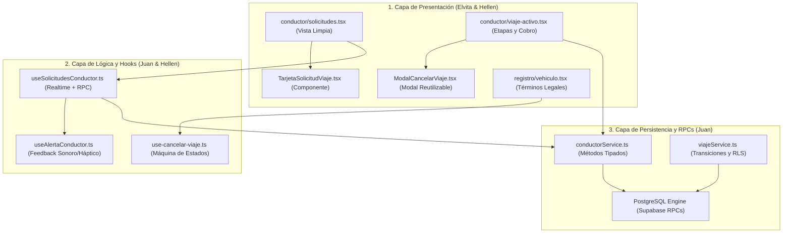
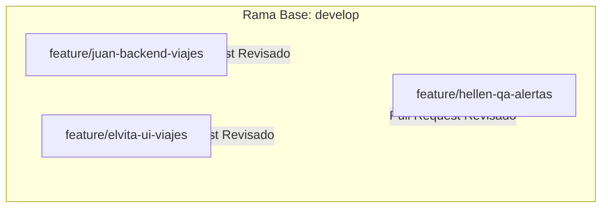

# PLAN DE DISTRIBUCIÓN DE TRABAJO Y PROTOCOLO TÉCNICO (V2.0 HARDENED)
## SPRINTS 2 Y 3: APLICACIÓN MÓVIL PARA TRANSPORTE URBANO EN BAGUA (ALTOKKE)

**Código del Proyecto:** `2026 – AMTUB - 001`  
**Institución:** Universidad Nacional Toribio Rodríguez de Mendoza de Amazonas  
**Facultad:** Facultad de Ingeniería de Sistemas y Mecánica Eléctrica  
**Curso:** Programación de Aplicaciones Móviles  
**Docente de Curso:** Mg. Eder N. Figueroa Piscoya  
**Asesora Metodológica:** Mg. Yuliana del Fátima Quiroz Vélez  
**Equipo de Trabajo:**
* **Juan Carlos Sandoval Núñez** (Líder Técnico, Backend Supabase, Concurrencia, RPCs y Hooks de Integración)
* **Elvita Donina Garro Gómez** (Ingeniera UI/UX Móvil, Maquetación de Pantallas y Componentes Visuales)
* **Hellen Shanela Mas Tuesta** (Ingeniera de Calidad, QA, Validaciones Legales, Alertas y Documentación Técnica)

---

## 1. RESUMEN EJECUTIVO DE LA AUDITORÍA DE CÓDIGO (ESTADO REAL VS ACTAS)

Tras una auditoría estricta de arquitectura confronted contra el repositorio local, la base de datos Supabase y la rúbrica oficial de la **Unidad II (20/20 pt)**, se certificó el estado operativo del proyecto:

1. **Sprint 2 (Flujo Pasajero) - ~75% Real:**
   * La solicitud (`confirmar-viaje.tsx`), la búsqueda reactiva (`buscando-conductor.tsx`), la escucha por WebSockets de Supabase (`useViajeEnVivo`) y la cancelación básica están operativas.
   * *Corrección Crítica Aplicada:* En `calificacion.tsx`, el modal de 5 estrellas, etiquetas dinámicas y comentarios ya están completamente construidos en frontend. El fallo de guardado en base de datos residía en que la pantalla del pasajero intentaba invocar `finalizarViaje` (violando la regla de autorización de la RPC) y la política RLS de `calificaciones` exige que el viaje esté en estado `finalizado` antes de admitir una reseña.
2. **Sprint 3 (Flujo Conductor) - 0% Real (100% Mock UI en Transición):**
   * *Diagnóstico:* Las pantallas `solicitudes.tsx` (888 líneas) y `viaje-activo.tsx` del conductor operaban con datos estáticos quemados en código (`PASAJERO_DEMO`, tarifa fija `S/ 4.94`). No existía suscripción a Supabase Realtime ni enlace al RPC `aceptar_viaje`.
   * *Riesgo de Regresión Mitigado:* El plan previo asignaba a dos integrantes a la vez a `solicitudes.tsx` y no asignaba `viaje-activo.tsx` del pasajero. Esta versión v2.0 establece **desacoplamiento total por hooks y contratos de componentes**, garantizando cero conflictos de Git en los pull requests hacia `develop`.
3. **Nuevo Requerimiento Normativo y Legal (LPDP Ley 29733 y MTC):**
   * Se incorpora formalmente el módulo de **Términos y Condiciones del Conductor** en el Paso 5 del registro (`vehiculo.tsx`), análogo al existente en pasajeros, con cláusulas de responsabilidad vial, verificación de SOAT urbano y consentimiento de tratamiento de datos.

---

## 2. MATRIZ GENERAL DE HISTORIAS DE USUARIO Y ASIGNACIÓN RECALIBRADA

| Código HU | Rol | Nombre de la Historia | Estado Real | Responsable Principal | Soporte / Revisión | Entregable Concreto |
| :--- | :--- | :--- | :--- | :--- | :--- | :--- |
| **HU-2.3** | Pasajero | Solicitar viaje | 90% Real | **Juan Carlos Sandoval** | Elvita Garro | Candado backend / validación en store |
| **HU-4.1** | Pasajero | Información del conductor | 85% Real | **Elvita Garro** | Hellen Mas | Fallback visual «Sin calificaciones» |
| **HU-5.1** | Pasajero | Seguimiento en mapa | 60% Estable | **Juan Carlos Sandoval** | Elvita Garro | Corrección de transición en `viaje-activo.tsx` |
| **HU-6.1** | Pasajero | Notificaciones push / In-App | 75% In-App | **Hellen Mas** | Juan Carlos Sandoval | Centro de notificaciones y alertas |
| **HU-7.1** | Pasajero | Pagar y calificar | 80% UI Lista | **Juan Carlos Sandoval** | Hellen Mas | Desbloqueo RLS + eliminación de llamada indebida |
| **HU-8.1** | Pasajero | Cancelar viaje con motivo | 85% Estable | **Hellen Mas** | Juan Carlos Sandoval | `ModalCancelarViaje.tsx` + motivo obligatorio |
| **HU-3.1** | Conductor | Ver solicitudes cercanas | 0% Mock | **Juan Carlos / Elvita** | Hellen Mas | `useSolicitudesConductor.ts` + `TarjetaSolicitudViaje` |
| **HU-3.3** | Conductor | Aceptar viaje (Antirace) | 0% Mock | **Juan Carlos Sandoval** | Elvita Garro | RPC `aceptar_viaje` con manejo de carrera |
| **HU-5.2** | Conductor | Seguimiento de etapas | 0% Mock | **Elvita Garro** | Juan Carlos Sandoval | `BarraProgresoViaje` + botones de avance en activo |
| **HU-6.5** | Conductor | Alerta sonora / háptica | 0% Pendiente | **Hellen Mas** | Juan Carlos Sandoval | `useAlertaConductor.ts` (API nativa segura) |
| **HU-7.2** | Conductor | Cobrar en efectivo y cerrar | 0% Mock | **Elvita Garro** | Juan Carlos Sandoval | Tarjeta de cobro `S/` + confirmación de pago |
| **HU-8.2** | Conductor | Cancelar viaje conductor | 0% Inexistente | **Hellen Mas / Juan** | Elvita Garro | `cancelar_viaje_conductor` + reapertura |
| **HU-1.4** | Conductor | Términos y Condiciones | 20% Parcial | **Hellen Mas / Elvita** | Juan Carlos Sandoval | Checkbox legal en Paso 5 de registro conductor |

---

## 3. ARQUITECTURA DE DESACOPLAMIENTO Y CONTRATOS DE COMPONENTES

Para evitar colisiones de Git en archivos monolíticos (`solicitudes.tsx`, `viaje-activo.tsx`), la arquitectura se desacopla en 3 capas independientes conectadas exclusivamente mediante interfaces tipadas de TypeScript:



### Contratos Oficiales de Interfaces (TypeScript)

#### A. Contrato: `TarjetaSolicitudViaje.tsx` (Responsabilidad: Elvita Garro)
*Ruta:* `src/features/viajes/components/TarjetaSolicitudViaje.tsx`
```typescript
export interface SolicitudViajeItem {
  id: string;
  pasajeroId: string;
  origenTexto: string;
  destinoTexto: string;
  tarifaEstimada: number;
  distanciaKm: number | null;
  metodoPago: string | null;
  creadoEn: string;
}

export interface TarjetaSolicitudViajeProps {
  solicitud: SolicitudViajeItem;
  onAceptar: (viajeId: string) => Promise<void> | void;
  onRechazar: (viajeId: string) => void;
  aceptando?: boolean;
}
```

#### B. Contrato: `ModalCancelarViaje.tsx` (Responsabilidad: Hellen Mas)
*Ruta:* `src/features/viajes/components/ModalCancelarViaje.tsx`
```typescript
export interface ModalCancelarViajeProps {
  visible: boolean;
  rol: "pasajero" | "conductor";
  advertenciaLlegada?: boolean; // True si el conductor ya se encuentra en el punto
  onConfirmar: (motivo: string) => Promise<void> | void;
  onCerrar: () => void;
  cargando?: boolean;
}
```

#### C. Contrato: `BarraProgresoViaje.tsx` (Responsabilidad: Elvita Garro)
*Ruta:* `src/features/viajes/components/BarraProgresoViaje.tsx`
```typescript
export interface BarraProgresoViajeProps {
  etapaActual: number; // 0: Aceptado, 1: En camino, 2: Te espera, 3: En viaje, 4: Llegó
  etapas?: string[];
  colorPrimario?: string;
}
```

---

## 4. FICHAS DETALLADAS DE TRABAJO POR INTEGRANTE (CERO COLISIONES)



---

### FICHA 1: JUAN CARLOS SANDOVAL NÚÑEZ
**Rol:** Líder Técnico, Backend Supabase, Concurrencia y Hooks de Integración  
**Rama de Trabajo:** `feature/juan-backend-viajes`  
**Archivos Candado Exclusivos (Nadie más edita estos archivos):**
* `supabase/migrations/*` (nueva migración de RPCs y parches de permisos)
* `src/features/viajes/services/viajeService.ts`
* `src/features/conductores/services/conductorService.ts`
* `src/features/viajes/store/viajeStore.ts`
* `src/features/viajes/context/ViajeContext.tsx`
* `src/features/viajes/hooks/use-solicitudes-conductor.ts` *(Nuevo hook de suscripción)*
* `src/features/viajes/screens/pasajero/viaje-activo.tsx` *(Retiro de llamada errónea de finalización y soporte de retorno a buscando)*

#### Tareas Técnicas Asignadas:
1. **Despliegue y Validación de Base de Datos (Supabase):**
   * Verificar la migración `20261113200000_flujo_estados_y_cancelacion_viajes.sql` en producción.
   * Asegurar que `cambiar_estado_viaje` valide estrictamente la secuencia: `aceptado` ➔ `en_camino_origen` ➔ `esperando_pasajero` ➔ `en_viaje`.
   * Verificar que `cancelar_viaje_conductor` libere `conductor_id = NULL` y reabra el viaje a `estado = 'buscando'`, registrando `motivo_cancelacion` y `cancelado_por`.
2. **Hook de Solicitudes y Concurrencia (`use-solicitudes-conductor.ts`):**
   * Construir el hook que consumirá Elvita en `solicitudes.tsx`:
     * Carga inicial mediante `conductorService.obtenerSolicitudesPendientes()`.
     * Suscripción WebSocket en vivo (`supabase.channel`) a cambios de la tabla `viajes` filtrados por `estado=eq.buscando`.
     * Manejo transaccional del botón "Aceptar viaje" llamando al RPC `aceptar_viaje` con captura del error `Solicitud no disponible` si otro conductor lo ganó milisegundos antes.
3. **Limpieza del Flujo Pasajero (`viaje-activo.tsx`):**
   * Retirar la llamada a `viajeService.finalizarViaje` del botón «Calificar viaje» en la pantalla del pasajero (esa operación es potestad exclusiva del conductor).
   * Agregar guardia reactiva: si el viaje en curso retorna a `buscando` y tiene `cancelado_por !== null`, notificar al pasajero que el conductor canceló y redirigir limpiamente a `buscando-conductor`.
4. **Desacoplamiento de `recargarHistorial` en `viajeStore.ts`:**
   * Modificar `recargarHistorial` para que, si no recibe `userId`, lo obtenga automáticamente de la sesión de Supabase (`supabase.auth.getUser()`), evitando que las pantallas fallen silenciosamente.

---

### FICHA 2: ELVITA DONINA GARRO GÓMEZ
**Rol:** Ingeniera de Interfaz, UX Móvil y Componentes Visuales  
**Rama de Trabajo:** `feature/elvita-ui-viajes`  
**Archivos Candado Exclusivos (Nadie más edita estos archivos):**
* `src/features/viajes/screens/conductor/solicitudes.tsx` *(Consumo del hook de Juan y maquetación de lista)*
* `src/features/viajes/screens/conductor/viaje-activo.tsx` *(Secuencia de botones de etapa y cobro)*
* `src/features/viajes/components/TarjetaSolicitudViaje.tsx` *(Nuevo componente modular)*
* `src/features/viajes/components/BarraProgresoViaje.tsx` *(Nuevo componente modular)*
* `src/features/viajes/components/TarjetaConductor.tsx` *(Insignia «Sin calificaciones»)*
* `src/features/conductores/screens/registro/vehiculo.tsx` *(Maquetación visual del bloque de Términos y Condiciones)*

#### Tareas Técnicas Asignadas:
1. **Modularización de `solicitudes.tsx` y Componente `TarjetaSolicitudViaje.tsx`:**
   * Extraer la tarjeta de solicitud fuera del archivo monolítico de 888 líneas y crear `TarjetaSolicitudViaje.tsx` siguiendo el contrato tipado.
   * Conectar `solicitudes.tsx` al hook `useSolicitudesConductor()` provisto por Juan, renderizando la lista con `FlatList` o `FlashList` con estados limpios (cargando, lista vacía, viaje disponible).
2. **Barra de Progreso y Acciones del Conductor (`HU-5.2` y `HU-7.2`):**
   * En `src/features/viajes/screens/conductor/viaje-activo.tsx`, maquetar la botonera dinámica de avance de etapa según el estado devuelto por el viaje:
     * Si `estado === 'aceptado'`: Botón «Voy en camino al pasajero».
     * Si `estado === 'en_camino_origen'`: Botón «Llegué al punto de encuentro».
     * Si `estado === 'esperando_pasajero'`: Botón «Iniciar viaje».
     * Si `estado === 'en_viaje'`: Botón destacado «Finalizar carrera».
   * **Tarjeta de Cobro en Efectivo:** Al llegar al final del viaje, renderizar la tarjeta con el monto final en soles (`formatearSoles`), desglose de tarifa y confirmación de «Efectivo recibido».
3. **Fallback en `TarjetaConductor.tsx` (`HU-4.1`):**
   * Si el conductor no cuenta con calificaciones previas (`viajes === 0` o `calificacion === null`), mostrar la etiqueta textual exacta «Sin calificaciones» estipulada en las actas de evaluación.
4. **Diseño de Términos y Condiciones en Registro de Conductor (Paso 5):**
   * En `src/features/conductores/screens/registro/vehiculo.tsx`, maquetar el contenedor visual de aceptación de términos legales antes del botón de envío, adaptado para modo claro y oscuro con la paleta institucional.

---

### FICHA 3: HELLEN SHANELA MAS TUESTA
**Rol:** Ingeniera de Calidad (QA), Reglas Funcionales, Alertas y Documentación  
**Rama de Trabajo:** `feature/hellen-qa-alertas`  
**Archivos Candado Exclusivos (Nadie más edita estos archivos):**
* `src/features/viajes/screens/pasajero/actividad.tsx` *(Pull-to-refresh y sincronización)*
* `src/features/viajes/hooks/use-cancelar-viaje.ts` *(Lógica de cancelación con motivo)*
* `src/features/viajes/components/ModalCancelarViaje.tsx` *(Nuevo componente modal con motivos)*
* `src/features/notificaciones/hooks/useAlertaConductor.ts` *(Nuevo hook de alerta auditado)*
* `docs/` *(Actas de Sprint 2 y 3, matrices de prueba y evidencias para el informe final)*

#### Tareas Técnicas Asignadas:
1. **Modal de Cancelación con Motivos Obligatorios (`HU-8.1` y `HU-8.2`):**
   * Crear el componente modular `ModalCancelarViaje.tsx` con motivos seleccionables:
     * *Motivos Pasajero:* "Demora del conductor", "Me equivoqué de destino", "Cambié de planes", "Otro motivo".
     * *Motivos Conductor:* "Problema mecánico", "Tráfico pesado", "Pasajero no responde", "Emergencia personal".
   * Regla de Negocio: Deshabilitar confirmación si no hay motivo seleccionado.
   * Regla de Advertencia: Si el conductor ya llegó al punto (`esperando_pasajero`), mostrar aviso destacado al pasajero indicando que el conductor ya está esperándolo en el lugar.
2. **Alerta Sonora / Sensorial del Conductor (`HU-6.5`):**
   * Crear `useAlertaConductor.ts` garantizando compatibilidad con **Expo SDK 58**.
   * Utilizar respuesta sensorial/vibración del sistema o sonido seguro mediante patrón auditado, evitando dependencias desactualizadas o incompatibles con React 19.
   * Silenciar la alerta si el conductor tiene el estado en pausa o ya tiene una carrera en curso.
3. **Validación Legal y Textos de Términos del Conductor:**
   * Redactar las cláusulas legales específicas del servicio de mototaxi en Bagua para el modal/alerta informativa de `vehiculo.tsx`:
     * Obligatoriedad de licencia de conducir clase B-IIc y SOAT vigente.
     * Respeto de tarifas urbanas vigentes y trato digno al usuario.
     * Protección de datos personales (Ley N° 29733).
   * Validar en el formulario que el envío de solicitud quede estrictamente bloqueado hasta que el checkbox esté marcado.
4. **Pruebas de Calidad e Informe Final (UND-II):**
   * Conectar el pull-to-refresh de `actividad.tsx` y validar la carga real contra Supabase.
   * Ejecutar la matriz de pruebas manuales requerida por la Guía de Unidad II (casos de éxito, error de concurrencia y ausencia de red) y redactar el Acta de Cierre de Sprint.

---

## 5. ESPECIFICACIÓN TÉCNICA DEL APARTADO DE TÉRMINOS Y CONDICIONES (CONDUCTOR)

En cumplimiento de la normativa peruana de protección de datos (Ley 29733) y las directivas del MTC para el servicio de transporte en vehículos menores (mototaxis), se establece la integración del bloque de términos en el Paso 5 del registro (`vehiculo.tsx`):

### 1. Cláusulas Legales Informativas (Modal / Alert)
```text
TÉRMINOS Y CONDICIONES DEL SERVICIO DE CONDUCTOR - ALTOKKE
1. Habilitación Legal: El conductor declara bajo juramento contar con Licencia de Conducir Clase B-IIc vigente y SOAT urbano aplicable a la ciudad de Bagua.
2. Compromiso Tarifario: El conductor se compromete a respetar la tarifa calculada por la plataforma y los métodos de pago pactados (efectivo / billetera digital).
3. Seguridad y Conducta: Queda terminantemente prohibido prestar el servicio bajo influencia de alcohol o sustancias estupefacientes, o permitir que terceros no autorizados conduzcan la unidad registrada.
4. Privacidad (Ley 29733): Los datos de ubicación, origen y destino de los pasajeros son confidenciales y se emplean exclusivamente para la ejecución del viaje.
```

### 2. Estructura de Validación en `vehiculo.tsx`
```typescript
// Estado local en vehiculo.tsx:
const [terminosAceptados, setTerminosAceptados] = useState(false);

// Regla en validarFormulario():
if (!terminosAceptados) {
  Alert.alert(
    "Términos requeridos",
    "Debes leer y aceptar los Términos y Condiciones del Conductor y la Política de Privacidad para enviar tu postulación."
  );
  return false;
}
```

---

## 6. AUDITORÍA DE SEGURIDAD DEFENSIVA Y PREVENCIÓN DE VULNERABILIDADES

### 1. Mitigación de Race Conditions (Colisión de Conductores en Aceptar Viaje)
* **Vulnerabilidad Potencial:** Dos mototaxistas pulsan «Aceptar viaje» exactamente al mismo segundo sobre la misma solicitud.
* **Defensa Implementada:** La función PostgreSQL `aceptar_viaje` opera con nivel de aislamiento atómico:
  ```sql
  UPDATE public.viajes 
  SET conductor_id = v_uid, estado = 'aceptado', aceptado_en = now()
  WHERE id = p_viaje_id AND estado = 'buscando' AND conductor_id IS NULL;
  
  IF NOT FOUND THEN 
    RAISE EXCEPTION 'Solicitud no disponible'; 
  END IF;
  ```
  El primer UPDATE bloquea la fila por clave primaria. El segundo conductor recibe inmediatamente `Solicitud no disponible`, y el hook `useSolicitudesConductor` captura la excepción mostrando: *"Esta carrera ya fue tomada por otro conductor cercano"*.

### 2. Bloqueo de Inversión de Roles y Falsificación de Estado
* **Vulnerabilidad Potencial:** Un pasajero manipula la consola para enviar una solicitud HTTP dando por finalizada la carrera o modificando la tarifa.
* **Defensa Implementada:**
  1. `finalizar_viaje` y `cambiar_estado_viaje` tienen `SECURITY DEFINER` con validación estricta de `auth.uid() = conductor_id`. Si el pasajero intenta ejecutarlas, PostgreSQL aborta la transacción con excepción inmediata.
  2. La tarifa final se asigna en el servidor a partir de `tarifa_estimada` previamente registrada, impidiendo manipulación de montos desde el cliente móvil.

### 3. Blindaje de RLS en Calificaciones
* **Vulnerabilidad Potencial:** Inyección de calificaciones falsas o reseñas sobre carreras no concluidas.
* **Defensa Implementada:** La política RLS `altokke_calificaciones_insert` exige que `v.estado = 'finalizado'` y que `autor_id` y `receptor_id` coincidan de manera unívoca con el par `(pasajero_id, conductor_id)` del viaje real.

---

## 7. PROTOCOLO ANTICOLISIÓN GIT (PASO A PASO)

```bash
# 1. Antes de iniciar la jornada, actualizar develop
git checkout develop
git pull origin develop

# 2. Crear o cambiarse a la rama asignada
# Para Juan:   git checkout -b feature/juan-backend-viajes
# Para Elvita: git checkout -b feature/elvita-ui-viajes
# Para Hellen: git checkout -b feature/hellen-qa-alertas

# 3. Trabajar ÚNICAMENTE en los archivos de la Ficha Asignada

# 4. Compilar obligatoriamente para certificar cero errores de tipos
npx tsc --noEmit

# 5. Registrar commits atómicos y claros en español
git add .
git commit -m "Implementa tarjeta modular de solicitud de viaje"

# 6. Sincronizar antes de subir cambios
git fetch origin
git rebase origin/develop

# 7. Publicar rama en GitHub para revisión
git push -u origin feature/tu-rama
```

---
*Documento v2.0 actualizado, validado y blindado contra drift arquitectónico para su distribución al equipo.*
